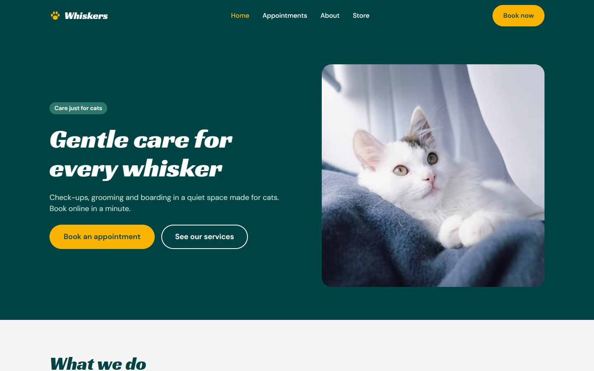
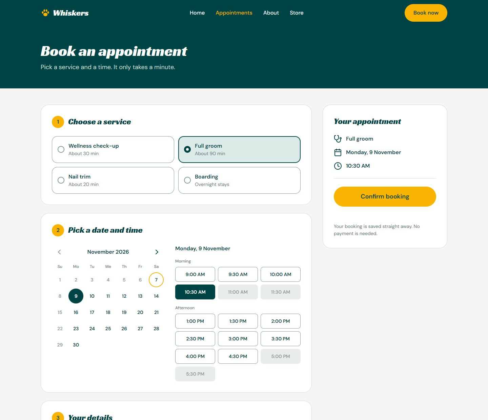
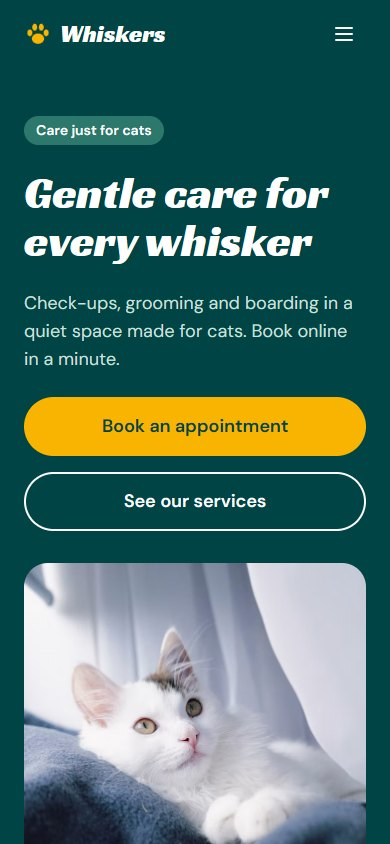
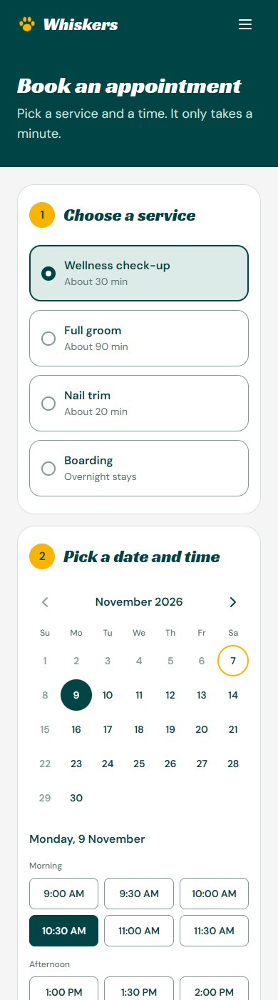

# Whiskers

A booking website for a cat care business. Visitors browse the services, pick a date and time on a
calendar, and book an appointment that is saved by an API.

It is a concept project: the business details (services, hours, phone, email, address) are placeholders.

<p align="center">
  
</p>
<p align="center">
  
</p>
<p align="center">
  
  &nbsp;&nbsp;
  
</p>

## Highlights

- **A real booking flow:** choose a service, pick a date and time, enter your details, get a confirmation.
- **Rules enforced on the server, not just in the browser:**
  - open Monday to Saturday, 9:00 to 12:00 and 13:00 to 18:00, in 30-minute slots
  - a service must finish before lunch or closing (a 90-minute groom cannot start at 11:00)
  - no double bookings, including overlaps between services of different lengths
  - no bookings in the past or more than 90 days ahead
  - if two people pick the same time, one gets a clear "just taken" message and the slots refresh
- **Responsive and accessible:** works from phone to desktop, with keyboard support, labelled form fields,
  visible focus, and screen reader announcements for errors and confirmations.
- **Tested:** 21 Angular tests and 32 .NET tests, including integration tests that run the real API in memory.

## Tech

| Part | Stack |
| --- | --- |
| Frontend | Angular 21 (standalone components, signals, reactive forms, lazy-loaded routes), TypeScript, SCSS |
| Backend | ASP.NET Core 10 Web API, Entity Framework Core (migrations), SQLite |
| Testing | Vitest, xUnit, `WebApplicationFactory` |
| Design | Figma (design tokens carried into the code as CSS variables) |

## Project layout

```
.
├── api/            ASP.NET Core Web API (controllers, EF Core models, availability rules, migrations)
├── api.tests/      xUnit unit and integration tests for the API
├── client/         Angular app
│   └── src/app/
│       ├── core/       API service, models, date helpers
│       ├── layout/     header and footer
│       ├── pages/      home, appointments (with calendar), coming-soon
│       └── shared/     icon component
├── docs/           Screenshots used in this README
└── Whiskers.slnx   Solution file for the API and its tests
```

## Run it locally

You need [Node.js](https://nodejs.org) 22 or newer and the [.NET 10 SDK](https://dotnet.microsoft.com/download).
Open two terminals.

Start the API (creates `api/whiskers.db` on first run):

```bash
cd api
dotnet run --launch-profile http        # http://localhost:5258
```

Start the Angular app:

```bash
cd client
npm install --legacy-peer-deps          # see the note below
npm start                               # http://localhost:4200
```

Open <http://localhost:4200>. The Angular dev server forwards `/api` to the .NET API
(see `client/proxy.conf.json`), so there are no CORS problems in development.

> **Note on `--legacy-peer-deps`:** with npm 10.9 a plain `npm install` can crash while resolving the
> test tooling ("Cannot read properties of null (reading 'edgesOut')"). The flag works around it.
> Newer npm versions may not need it.

## Run the tests

```bash
cd client && npm test -- --watch=false      # Angular, 21 tests
cd api.tests && dotnet test                 # .NET, 32 tests
```

The .NET integration tests start the real API in memory with a throwaway database and a fixed clock.

## API

| Method | Path | Purpose |
| --- | --- | --- |
| `GET` | `/api/services` | List bookable services |
| `GET` | `/api/appointments/availability?date=YYYY-MM-DD&serviceId=1` | Every slot for a day, and whether it is free for that service |
| `POST` | `/api/appointments` | Book. Returns `201`, `400` (validation) or `409` (time taken or not allowed) |
| `GET` | `/api/appointments/{id}` | Look up one booking |

In development the OpenAPI document is at `/openapi/v1.json`.

## Design decisions worth knowing

- **Times are clinic-local with no time zone.** A booking is "10:30 on 12 November at the clinic", so the
  client and API pass plain `2026-11-12T10:30:00` values and never convert through UTC.
- **The database is the last line of defence.** The availability check runs first, and a unique index on the
  start time catches two people booking in the same instant.
- **There is no endpoint that lists all appointments.** There is no login yet, so exposing customers'
  names and emails would be a privacy problem.
- **Design tokens live in `client/src/styles.scss`** and match the variables in the Figma design.
- **Form borders are slightly darker than in the Figma design** so they meet the 3:1 contrast guideline.

## Not built yet

- **Email confirmations.** A booking is saved but no email is sent. The UI says so.
- **Staff login** and an admin view of bookings, plus cancelling or rescheduling.
- **About and Store pages.** They show a placeholder.
- **Deployment.** For production, serve the built Angular app (`npm run build`) from the same host as the API,
  or set the allowed origin in `api/appsettings.json`, and swap SQLite for SQL Server or PostgreSQL by changing the
  EF Core provider and connection string.

## History

This repository started as a React + Vite prototype of the site. That version is kept in the git history
(see the commit "added for lulz").

## Credits

Photos are free stock photos; check each photo's license page and credit the photographers if you want to
(the Unsplash License does not require it). Icons are drawn as inline SVG. Fonts are
[Racing Sans One](https://fonts.google.com/specimen/Racing+Sans+One) and
[DM Sans](https://fonts.google.com/specimen/DM+Sans) from Google Fonts.
